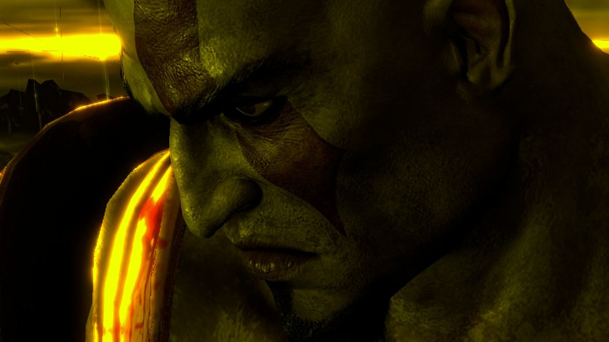
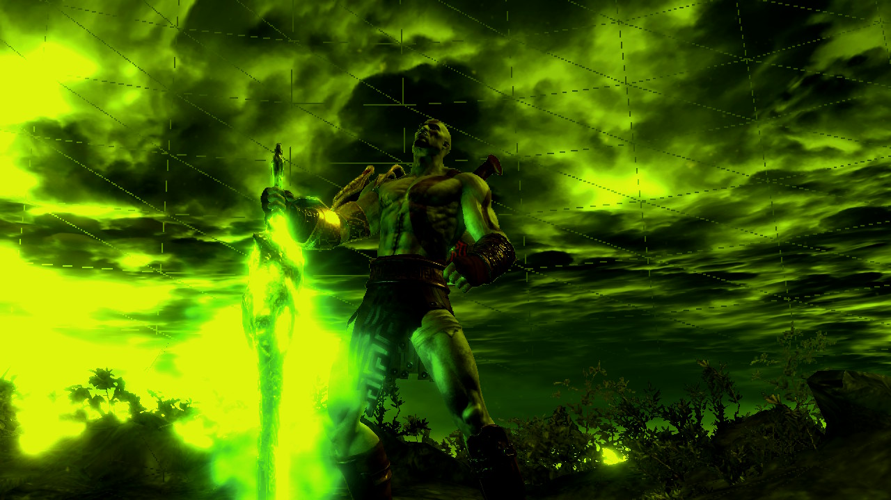
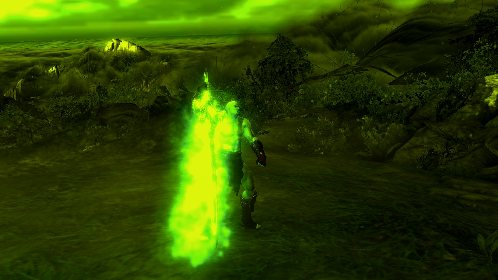
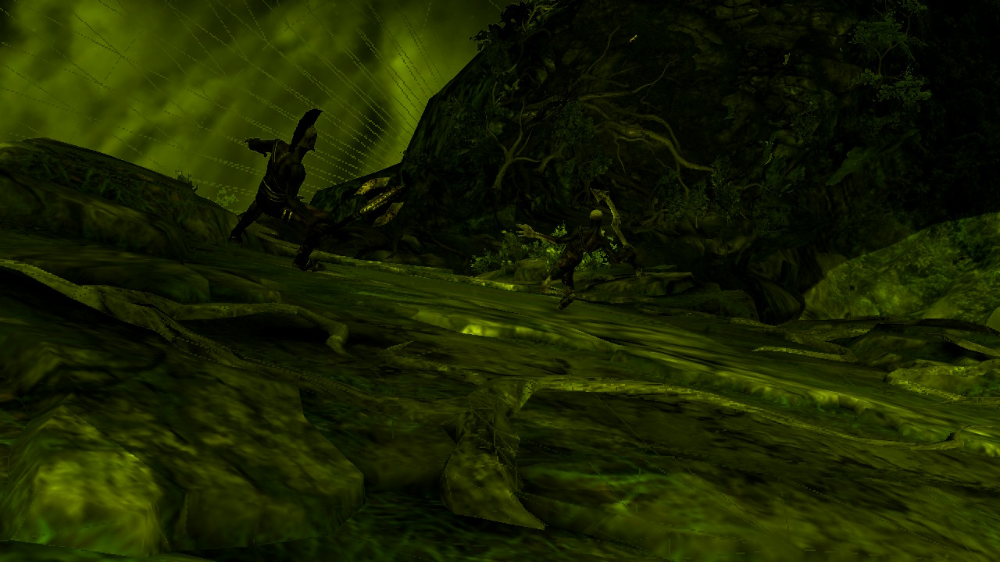

# gow3-nx — registro del port

Lo más nuevo arriba. Todas las pruebas son en consola por nxlink. Las mediciones marcadas **OC** son con overclock; la meta (30 FPS) se mide sin OC.

## 2026-11-28 (tarde) — ~0,88-1,0 s por cuadro (sin OC), cierre de la semana
- **Giro antes de bloquear en el mutex de los atómicos de SPU** (`spu_lockline_lock`, GETLLAR/PUTLLC): en Horizon dormir en el kernel (`svcArbitrateLock`) cuesta mucho más que girar. Barrido (cuadros 3600-3780, `SPU_LOCKLINE_SPIN_NS`): 2 µs → 1489 ms, 20 µs (el de antes) → 881 ms, **100 µs → 710 ms (−19 %)**, 1 ms → 1220 ms. **La confirmación NO repitió:** con 100 µs por defecto dio 1026 ms y además se colgó (RSX parado en un hueco de EDGE). Los 710 ms fueron una corrida con suerte: la variación entre corridas es grande. El código queda con 100 µs por defecto en el parche, pero la build recomendada es la 133 (20 µs, 881 ms, pasó 4 de 4).
- **Directorio de policy modules sin lock global** (`spurs_policy.c`): contadores atómicos, el lock solo se toma si se está retirando un workload. −3 % (881 contra 911 ms).
- Perfil del worker EDGE con la build 131: ya no duerme en el DMA; 36 % bloqueado en mutex (el de los atómicos y el del directorio), 30 % ocioso en condvar, ~1/3 de trabajo real. Los 3 núcleos van casi llenos (~2,7-2,9).
- Descartado: el mismo giro en los RwLock (`SRW_SPIN_NS=100000`: 1078 ms, peor; la perilla queda apagada).

### Capturas (consola, sin OC, sacadas solas por el bench con sys-botbase)
Cinemáticas con el motor del juego y un momento jugando. Las rayas punteadas del cielo ya estaban antes; todavía están por arreglar.

### Próximos pasos (en orden)
1. **Medir con más de una corrida por cambio** (la variación es grande) y encontrar el cuelgue de la build 134 (¿giro de 100 µs, directorio sin lock, o algo que ya estaba?). Volver el giro a 20 µs hasta entenderlo.
2. **Menos peleas por el mutex de los atómicos:** hoy hay un único mutex para todas las líneas de 128 B. Partirlo por línea (stripes) o sacar del camino los sondeos con GETLLAR del policy module de WWS.
3. **Hilo del RSX:** pasa ~44 % del tiempo en Vulkan (cada `vkQueueSubmit` ~3,7 ms, espera de fences ~5,8 ms por flush, ~67 flushes por cuadro). Ver si `queue_mu` choca con el present y juntar los flushes "de ocioso".
4. **Registro por draw de EDGE:** encontrar quién escribe la palabra 3 (`0x7012E510..E580`) con `PPU_WWATCH`. Hoy `EDGE_REC_SKIP` toma el camino del tope del propio job. Revisar la imagen en más escenas.
5. **Lifter SPU con registros en variables C**, bien hecho: sin volcar registros alrededor de los accesos al LS, solo en salidas, llamadas y canales. Recién cuando EDGE quede limitado por cálculo.
6. Liftear los fragmentos que todavía corren interpretados (img 0x132 LS 0x7C00/0x5C00; PM de WWS 0x17400/0x9C00/0x17800).
7. A largo plazo: EDGE → GPU (skinning y transformación en vertex shader).
- Herramienta: la primera conexión a sys-botbase a veces da timeout; agregar un reintento automático al runner de devkitnx.

## 2026-11-28 — jugable en el primer nivel: de ~2,1 s a 0,91 s por cuadro (sin OC)
- Mediciones con relojes de fábrica, cuadros 3600-3780 del bench (jugando, Kratos con la Espada del Olimpo bien dibujado). Sigue muy lejos de 30 FPS (~1,1 FPS).
- **EDGE en 3 SPU a la vez:** se perdía el 9.º argumento `maxContention` de `_cellSpursWorkloadAttributeInitialize` (va en la pila, SP+0x70), así que cada lista de jobs corría en una sola SPU. Ahora se respeta, con tope 3 (`SPURS_MAXCONT_CAP`). +60 %.
- **Tail calls de SPU con GCC ≥ 15** (`musttail`): el lift de EDGE tiene ~925 funciones y antes cada salto volvía al trampolín.
- **Sombras apagadas** (`GOW3_NO_SHADOWS`, def. 1) por el camino "apagado" del propio efecto.
- **El job EDGE ya no se queda dormido en su registro por draw** (`EDGE_REC_SKIP`, def. 1): sondeaba un registro de 16 B hasta que la palabra 3 valiera 0, con un tope propio de 10000 sondeos (~5-10 ms en PS3); acá cada sondeo dormía, el tope nunca llegaba y cada espera duraba 3-45 ms. Ahora, pasados 256 sondeos, toma el mismo camino que en su tope. **−20 % por cuadro** (1139 → 911 ms).
- Descartado: worker que elige solo su siguiente workload (con maxContention > 1 rompía la lista libre del allocator: doble free), espera por dirección en cada PUT de SPU (+29 % y cuelgue), 4 segmentos de Vulkan (igual).
- Lo que sigue: el hilo del RSX pasa ~44 % del tiempo en Vulkan (submit + fences), y EDGE sigue siendo ~2 núcleos.

## 2026-11-27 — llega al menú principal sin cuelgues (~315 ms/flip, OC)
- **El "cuelgue" del label 0x4F0 era un falso positivo.** En `cellGcmSys.c` (bloque NV406E 0x68) el timer de
  `GCM_SEMA_ACQUIRE_MS` solo se reiniciaba al rendirse y no al pasar: el bloqueo siguiente contaba desde uno viejo y se
  rendía en el acto. Los flips nunca se paraban. **Fix:** el timer se reinicia cuando el acquire pasa.
- **Revertido** el parche de prueba que forzaba el CLEAR del semáforo en el lift del PPU: ya no hace falta.
- **Benches (OC 1785/921):** con el fix y también con espera infinita (sin `_MS`), 0 rendiciones, **2.351 y 2.424 flips
  sin cuelgue** (antes se colgaba en el ~1.484) y llega al **menú principal a 307-318 ms/flip** (~3,2 FPS).
- **EDGE identificado:** los jobs de geometría EDGE son los relocables `rjm_434600` (imagen 306, la que corre en el
  menú) y `rjm_459100` (312, con un bloque extra de culling de triángulos), como las dos builds de EDGE de
  [Ascension-R](https://github.com/rigaz29/Ascension-R). En el menú el main espera a EDGE el ~36 % del frame; cada
  worker 8-10 usa ~19 % de un hilo y los 3 núcleos van al 88-99 %.
- **Hallazgo:** en Switch **ningún hilo tiene prioridad propia**: `apply_priority` (`win32_compat.c`) no hace nada en
  Switch, así que el `TIME_CRITICAL` del audio y el `ABOVE_NORMAL` del PPU no se aplican.
- **Descartado:** `SPURS_IDLE_MAX=1` (más sondeo: 375 ms/flip, peor).
- **Pendiente:** líneas finas punteadas en grilla sobre la imagen del menú (artefacto de render).
- **Próximo paso:** A/B de prioridades selectivas para los workers de SPURS (audio y EDGE); si no baja la espera del
  main, re-liftar EDGE (`--merge-chunks`) y después HLE nativo NEON de sus funciones calientes.

## 2026-11-13 — pausa (ya terminada) y plan de esa semana
El desarrollo se frena unos días: **se me acabaron los tokens de la IA con la que trabajo el port y se renuevan la
semana que viene.** El estado de abajo es exactamente donde quedó; se retoma desde el punto 1 del plan.

### Plan para la próxima semana (en orden)
1. **Probar el build pendiente (47ª):** draw batching de Vulkan (`VK_DRAW_BATCH=1`) + flush del lote al final de cada
   pasada del FIFO. Con batching solo, el juego se colgó en el flip 870.
   - Si ya no se cuelga: medir ms/frame en la fase de juego contra la 45ª (~355 ms/frame) y perfilar de nuevo el hilo del RSX.
   - Si se cuelga igual: revisar la carrera del estado del flip (`cellGcmResetFlipStatus` contra la entrega del tick)
     y la señal de `GET_REPORT` a las tareas SPU; buscar en Ghidra quién escribe el u16 que el PPU espera en `0x26D3D0`.
2. **Bajar el costo del hilo del RSX** (hoy el techo, ~200 ms/frame): menos esperas de fence (la de NVK duerme en
   sondeo), readbacks de color/zdepth sin bloquear, present encolado (como RPCS3) en vez de esperar dentro del hilo.
3. **Solapar PPU y RSX:** hoy corren casi en serie (el PPU espera ~150 de cada 339 ms).
4. Con el RSX liviano, volver al **mantra**: HLE de jobs SPU (Big 111/112, cobertura del lift como en Ascension-R),
   parches de post de RPCS3 (DoF, motion blur, bloom, fog) como interruptores, resolución dinámica + FSR1.

### Probabilidades (estimación honesta, hoy)
| Meta | Probabilidad |
|---|---|
| Que corra estable hasta el gameplay | ~70 % |
| 10 FPS sin OC | ~45 % |
| 15-20 FPS | ~30-40 % |
| 30 FPS sin OC | ~10 % |

## 2026-11-13 — de ~1,9 a ~3 FPS (OC); el cuello pasó de las SPU al hilo del RSX
Progreso medido en consola (flips por segundo, OC):

| Prueba | Cambio | FPS (OC) |
|---|---|---|
| 31ª-34ª | CPU por núcleo y por hilo: los 3 núcleos disponibles al 97-99,8 % | ~1,9 |
| 35ª | Backoff (sleep) en la espera de job-counter del PPU: PPU 84 → 58 % de CPU | ~2,15 (+12 %) |
| 39ª | `SPU_LS_NO_DIAG` (portado de Ascension-R) | ~2,20 (+3 %) |
| 40ª | **MLAA off** (parche de RPCS3 1.00 como interruptor `GOW3_NO_MLAA`) | **~2,98 (+35 %)** |
| 43ª | Caché por hash de la LUT 3D de color grading dentro del job SPU (bit-idéntico, `bad 0`) | ~3 (Little libera CPU) |

**Hallazgos:**
- **Perfilador SPU por job module** (`sprof`): el worker "Little" era casi todo `rjm_42d900` = la **LUT 3D de color
  grading** (32×32×32 RGBA8, 61 % de un hilo, la misma cada frame). Cacheada: ya no cuesta.
- El float SPU ya iba por NEON con FPCR RZ+FZ; el camino escalar frío es <1 % (descartado como costo).
- **Trazas (`PS3_FTRACE`, 44ª):** el PPU no está limitado por las SPU sino que **espera al RSX**: frame de ~339 ms,
  drain del RSX ~200 ms/frame con una pasada de hasta 154 ms. PPU y RSX quedan casi en serie.
- **Muestreador del hilo del RSX en Horizon** (`RSX_WALKER_PROF`, con `svcGetThreadContext3`; 45ª): el hilo pasa
  ~90 % esperando: `vk_submit_and_wait` **por cada draw** (submit 33 %, espera de fence 34 % + 23 %). Trabajo real <10 %.
- `env.txt` en la SD (`sdmc:/switch/gow3-nx/env.txt`) pisa los defaults: los A/B ya no necesitan recompilar.
- Otros parches 1.00 listos para usar: DoF, motion blur, layered fog y bloom.

**En curso:** draw batching (hasta 512 draws por submit). La 46ª se colgó en el flip 870 (hilo del RSX ocioso, FIFO
vacío, PPU esperando un u16 en `0x26D3D0`); el build con flush al final de cada pasada está compilado, sin probar.

**Descartado:** `GOW3_NO_COLORGRADE` como parche (cuelga a los 51 s), dar 2 workers a Little, fijar hilos a núcleos
(no hay núcleo libre), reescribir el float SPU a NEON (ya lo era).

Herramientas nuevas en `tools/`: `wbase.py` (base de carga del NRO desde las muestras) y `wsym.py` (simboliza el wprof).

## 2026-11-12 — pantalla de brillo; los jobs SPU se quedan sin hilos
- El video de intro (`SMLOGO.M2V`) termina (`EndSeq` + `Close`) y aparece la **pantalla de calibración de brillo**, bien dibujada.
- Se cuelga ahí: los 128 ids de tareas del taskset de partículas se agotaban porque `pthread_create` falla y el id no se liberaba. Arreglado con una cola diferida, pero los jobs encolados no corren: el fallo es ENOMEM al reservar stacks de 16 MB con 6 hilos vivos.
- **Próximo:** pool fijo de workers SPU, stacks más chicos, medir el heap libre; `cellSpursJoinTask2`; input.

## 2026-11-12 — video de intro sin FFmpeg
- `cellVdec` sin FFmpeg nunca llenaba `CellVdecMpeg2Info` (frame rate 0, pts -1): el reproductor no terminaba nunca. Ahora saca el frame rate del header de secuencia MPEG-2, sintetiza los pts y usa una cola de 32 imágenes. Los cuadros se ven en negro (falta decodificar de verdad).

## 2026-11-12 — imagen con los shaders del juego
- Backend Vulkan sobre **NVK** en la consola (swapchain 1280×720). glslang 11 compilado para Switch: los shaders del RSX van HLSL → SPIR-V en la consola, con caché en la SD. 32 pipelines, 0 fallas.
- Se ven los logos y los créditos del estudio a ~45 FPS. Desde el video baja a ~3,8 FPS.

## 2026-11-12 — 10 minutos estable con RSX null
- El parking del FIFO del RSX descartaba los command buffers de EDGE que todavía llenaba el SPU (gracia de 50 ms). Con más gracia y semáforos de acquire, flipea estable a ~4,4 FPS durante 9 min.
- Edge zlib, SPURS, PM de WWS y fios funcionando. Título leído de `PARAM.SFO` (antes caía en un placeholder).

## 2026-11-11 — primer arranque en consola
- Lift completo del PPU (con stubs HLE) y de las SPU: 8 ELF, el policy module de WWS y 19 jobs relocables.
- Runtime de ps3recomp compilado para AArch64 con libnx: memoria guest de 4 GB, puente de excepciones a la tabla de señales, compat POSIX.

## 2026-11-11 — elección de ruta
- Se descartó la versión de PS4 (no hay binarios ARM64; FEX/JIT no es viable en Horizon) y se eligió **recompilación estática de la versión de PS3** con ps3recomp.
